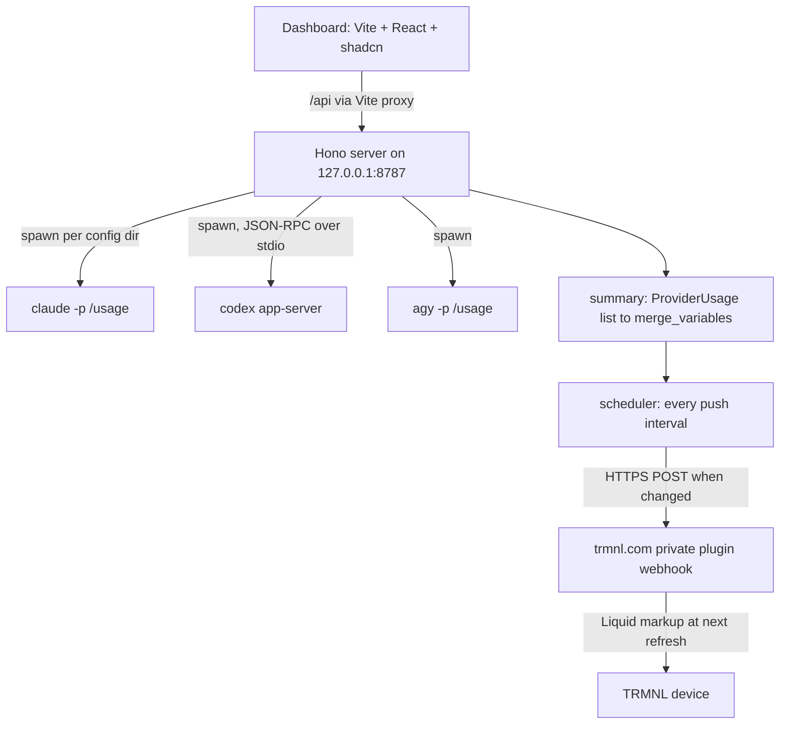
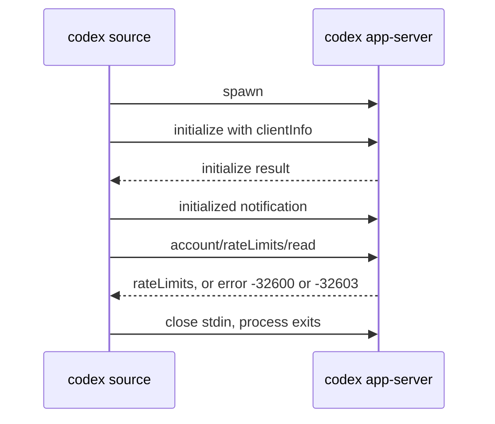
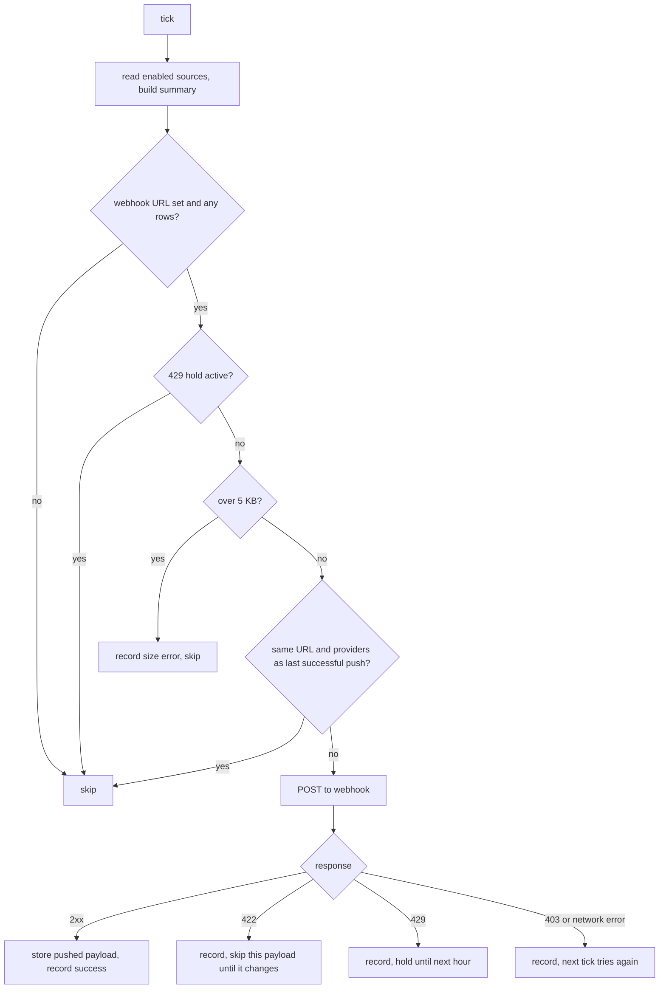

# TRMNL Dash Proof of Concept - Plan

## Goal Capsule

- **Objective:** A person with a TRMNL Developer Edition device can glance at it and see how much of their Claude Code, OpenAI Codex and Google Antigravity plan limits they have used and when each window resets, while their laptop runs TRMNL Dash. Each Claude Code installation and each Antigravity model group gets its own row.
- **Means:** a local Hono server reads usage from each official CLI, summarizes it into merge variables under 5 KB, and pushes them to a TRMNL private plugin webhook; a local Vite + React + shadcn/ui dashboard adds and manages sources and the webhook (R5–R8, R16–R17, KTD1–KTD5, KTD9).
- **Authority:** the guardrails in `CLAUDE.md` come first, then this plan's Requirements, then its Key Technical Decisions, then the Implementation Units. A unit never overrides an R or a KTD.
- **Execution profile:** one pull request on the working branch, with one commit per unit, built in U-ID order (U1 through U8). U1 and U4 need the person's device, U5 to U7 their signed-in CLIs, and U8 their browser.
- **Who finishes:** the implementer builds every unit. The person creates the TRMNL private plugin, pastes the markup, copies the webhook URL into the dashboard, adds each source in the dashboard, and confirms the device shows the push.
- **Stop conditions:** stop and ask when real CLI output contradicts a KTD's field mapping in a way that changes the payload, or when TRMNL rejects the markup.

---

## Product Contract

### Summary

Build the proof of concept in six milestones: prove the device path with a hand-pushed payload, build the server's summary, webhook client and scheduler against fake readings, then replace the fake readings with the Codex, Claude Code and Antigravity sources one at a time, and finish with the dashboard pages.

### Problem Frame

People who use Claude Code, Codex and Antigravity on paid plans hit rolling 5-hour and weekly limits, and each CLI shows its own usage only inside its own session. Many run more than one Claude Code installation, such as two accounts, each with its own limits. A TRMNL e-ink device on the desk can show all of them at once without opening a terminal. The constraints shape everything else. Each CLI owns its own sign-in, so TRMNL Dash may read usage only through those CLIs. The laptop sits behind NAT, so the server pushes outbound and never needs a public URL. TRMNL allows 5 KB of merge variables and 12 pushes per hour, so the summary has to be small and pushed only when it changes.

### Requirements

**Device and payload**

- R1. The device shows one row per reading (each Claude Code installation, each Codex home, and each Antigravity model group), at most five rows, with session and weekly usage as a percentage, each window's reset time, and a last-updated time, using the merge variables and markup in Interface Contracts. A row draws a window's bar only when its source reports that window, so a plan without a 5-hour limit shows no empty session bar.
- R2. The serialized merge variables stay at or under 5 KB. An oversized summary is refused before it is posted.
- R3. The server pushes at most once per push interval (default 10 minutes, at least 5) and only when the provider rows differ from the last successful push, so it stays under 12 pushes per hour.
- R4. A 422 (too large) or 429 (rate limited) response never starts a retry loop.

**Usage sources**

- R5. Claude Code usage comes from `claude -p /usage`, run on every read with each installation's `CLAUDE_CONFIG_DIR`, or with it unset for the default `~/.claude`. It reports the weekly window only, because the plans in use have no 5-hour session limit.
- R6. Codex usage comes from `codex app-server` over stdio JSON-RPC, run with each Codex source's `CODEX_HOME`.
- R7. Antigravity usage comes from `agy -p /usage`, with one reading per model group.
- R8. TRMNL Dash never reads, stores or mints a provider token and never calls a provider's HTTP API. Sign-in happens in each CLI (`claude`, `codex login`, `agy`), and the dashboard only reports whether each source is working.
- R9. A failed read keeps the last good reading and sets `ok: false` with an error, so the device never blanks on one bad poll. A window whose `resetsAt` has passed is shown as 0%.

**Server and secret**

- R10. The server binds to `127.0.0.1:8787` only. It answers 403 to a request whose `Host` is not `127.0.0.1:8787` or `localhost:8787`, or whose `Origin`, when present, is not on `localhost` or `127.0.0.1`, so a web page cannot reach the routes through DNS rebinding or a cross-site request.
- R11. The TRMNL webhook URL is the one secret. It lives in `server/data/config.json` (gitignored, mode 0600), is masked on read, and never appears in logs or responses.

**Dashboard**

- R12. The Sources page shows one card per source with status, last readings, an on/off switch, a Test button and a Remove button. When a source fails it shows the CLI command that fixes it. A Claude Code or Codex card shows its label and config dir. An Add a source form picks Claude Code, Codex or Antigravity; Claude Code and Codex take a label and a config dir, and Antigravity takes nothing and is disabled once added. With no sources the page says so. The Antigravity card lists one reading per model group.
- R13. The TRMNL page sets the webhook URL and push interval and has a Push now button.
- R14. The Preview page shows the exact payload JSON and its byte size, and the screen `trmnl/full.liquid` draws from it at the original device's 800×480.
- R15. The UI uses shadcn/ui defaults with no custom styling.

**Sources**

- R16. A source is one Claude Code config dir (`CLAUDE_CONFIG_DIR`), one Codex home (`CODEX_HOME`), or Antigravity, which has at most one source. The server lists sources in `server/data/instances.json` (gitignored). There are no default sources: the person adds each one in the dashboard, `~/.claude` and `~/.codex` included, and the device shows only what they added.
- R17. Adding or removing a source changes only `instances.json` and that source's on/off switch. The server writes nothing in a config dir, and `claude -p /usage` runs with `--no-session-persistence` so a read leaves no session transcript behind.

### Acceptance Examples

- AE1. Covers R9. **Given** Codex read 10% session usage at 18:00, **when** the 18:10 read fails, **then** Codex keeps 10% with `ok: false` and the error, and the device still shows 10%.
- AE2. Covers R9. **Given** a source's last reading has a session window that resets at 20:00, **when** the summary is built at 20:05 with no newer reading, **then** the session shows 0%.
- AE3. Covers R3. **Given** the last successful push carried the same provider rows, **when** the scheduler ticks, **then** nothing is posted.
- AE4. Covers R4. **Given** TRMNL answered 429 at 18:20, **when** the scheduler ticks at 18:30 and 18:40, **then** nothing is posted before 19:00.
- AE5. Covers R2, R4. **Given** a summary of 5.2 KB, **when** a push is due, **then** nothing is posted and the TRMNL page shows the size error.
- AE6. Covers R5, R16. **Given** the person added `~/.claude-work` as "Claude work", **when** the server reads Claude usage, **then** it runs `claude -p /usage` with `CLAUDE_CONFIG_DIR` set to `~/.claude-work`, and the reading has key `claude:work`, name "Claude work" and only a weekly window.
- AE7. Covers R7, R9. **Given** Antigravity read two model groups at 18:00, **when** the 18:10 `agy` run fails, **then** both groups keep their 18:00 values with `ok: false`.

### Interface Contracts

These carry over from the original proof-of-concept plan, with the markup updated to TRMNL Framework 3.4. U1 copies the markup to `trmnl/full.liquid` and the sample payload to `trmnl/sample-payload.json`, and those files own them from then on.

**Data model** (shape, in `server/src/types.ts`):

```ts
type Window = { usedPct: number; resetsAt?: string }; // ISO 8601
type ProviderUsage = {
  provider: 'claude' | 'codex' | 'antigravity';
  key: string;  // 'claude:work', 'codex:default', 'antigravity:<group>'
  name: string; // the row label on the device
  ok: boolean;
  error?: string;
  fetchedAt: string;
  windows: Record<string, Window>; // session, weekly, ...
};
```

A source produces one or more readings: one for each Claude installation (source id `claude:<slug>`), one for each Codex home (`codex:<slug>`), and one per model group for Antigravity (`antigravity`). Each source keeps its last good readings. A failed read sets `ok: false` and keeps the old values, for every Antigravity group at once.

**Sources** in `server/data/instances.json`, empty until the person adds one:

```json
[
  { "id": "claude:work", "provider": "claude", "label": "Claude work", "configDir": "/Users/me/.claude-work" },
  { "id": "codex:default", "provider": "codex", "label": "Codex", "configDir": "/Users/me/.codex" },
  { "id": "antigravity", "provider": "antigravity", "label": "Antigravity" }
]
```

`configDir` is an absolute path. The file holds no secret.

**Payload** the server pushes to `https://trmnl.com/api/custom_plugins/<uuid>`:

```json
{
  "merge_variables": {
    "updated": "Nov 26 18:40",
    "providers": [
      { "name": "Claude", "weekly": 61, "weekly_reset": "Mon" },
      { "name": "Claude work", "weekly": 12, "weekly_reset": "Wed" },
      { "name": "Codex", "session": 10, "session_reset": "21:15", "weekly": 33, "weekly_reset": "Fri" },
      { "name": "Agi Gemini", "session": 5, "session_reset": "19:10", "weekly": 18, "weekly_reset": "Sun" },
      { "name": "Agi Other", "session": 0, "session_reset": "", "weekly": 0, "weekly_reset": "" }
    ]
  }
}
```

A row carries `session` and `session_reset` only when its reading has a session window, and `weekly` and `weekly_reset` only when it has a weekly window. A window with no known reset carries an empty reset string. Antigravity rows are named "Agi Gemini" for the group whose name contains Gemini and "Agi Other" for any other group, so titles fit a two-column layout. Each extra installation or group adds a row, and U1 checks that five rows fit the Full layout. The summary keeps the first five rows in source order (Claude installations, then Codex homes, each in the order they were added, then Antigravity groups as `agy` prints them) and leaves the rest out. Turning a source off in the dashboard frees its rows.

**Full layout markup** (TRMNL adds the `view` wrapper). Rows flow into a two-column grid, three grid rows for five readings:

```html
<div class="layout layout--col layout--top layout--stretch-x">
  <div class="grid grid--cols-2">
    
    <div class="col">
      <span class="title">{{ p.name }}</span>
      
      <div class="progress-bar">
        <div class="content">
          <span class="label">Session · resets {{ p.session_reset }}</span>
          <span class="value value--xxsmall">{{ p.session }}%</span>
        </div>
        <div class="track"><div class="fill" style="width: {{ p.session }}%"></div></div>
      </div>
      
      
      <div class="progress-bar">
        <div class="content">
          <span class="label">Weekly · resets {{ p.weekly_reset }}</span>
          <span class="value value--xxsmall">{{ p.weekly }}%</span>
        </div>
        <div class="track"><div class="fill" style="width: {{ p.weekly }}%"></div></div>
      </div>
      
    </div>
    
  </div>
</div>
<div class="title_bar"><span class="title">AI usage</span><span class="instance">{{ updated }}</span></div>
```

Liquid treats only `nil` and `false` as false, so `` draws a bar at 0% and skips a missing key. New data appears at the plugin's next scheduled refresh.

**Server routes:**

| Route | Purpose |
|---|---|
| `GET /api/sources` | Status, provider, config dir and last readings for each source |
| `POST /api/sources` | Add a source (`provider`, and `label` and `configDir` for Claude Code and Codex) and read it once |
| `DELETE /api/sources/:id` | Remove a source, its readings and its on/off switch |
| `POST /api/sources/:id/test` | Read one source now |
| `PUT /api/sources/:id` | Turn a source on or off |
| `GET /api/trmnl` / `PUT /api/trmnl` | Webhook URL (masked on read), push interval, and the last push result |
| `GET /api/trmnl/preview` | Exact payload and its byte size |
| `GET /api/trmnl/screen` | HTML of `trmnl/full.liquid` rendered with the payload's merge variables in TRMNL's page shell |
| `POST /api/trmnl/push` | Push now, even when the provider rows are unchanged |

### Scope Boundaries

- TRMNL+ limits (10 KB, 30 pushes per hour) are not used. The server holds to the standard limits on every account.
- No hosting, public URL or inbound webhook. The server runs on the person's machine.
- One person and one device. No TRMNL Dash accounts, sharing or multiple webhooks.
- Codex shows only its default rate-limit bucket (`rateLimits`), not every bucket in `rateLimitsByLimitId`.
- Claude shows only the `Current week (all models)` line of `/usage`. Per-model weekly lines, such as `Current week (Fable)`, are left out.
- Two installations signed in to the same account report the same numbers. They stay separate rows, and the person's labels tell them apart.
- The device shows no per-row failure or staleness. A failing or idle source keeps showing its last values, and only the dashboard shows the error.

Considered and not built:

- Forwarding Claude Code's `statusLine` `rate_limits` through a wrapper command installed in each config dir's `settings.json`. It was the only documented source of the 5-hour session window, but the plans in use have no session limit, and polling `/usage` covers idle installations without editing the person's settings.

- Retrying a failed network push before the next tick. The next tick retries anyway, and the TRMNL page shows the failure. Revisit if pushes fail often enough to leave the device stale.
- Keeping readings across a server restart. The device keeps showing the last push. Every source refills within one interval. Revisit if restarts become common.
- Reading a `Retry-After` header on 429. TRMNL does not document one, so the server waits for the next hour (KTD5).
- Listening for Codex's `account/rateLimits/updated` notification (KTD1).

#### Deferred to Follow-Up Work

- A README setup section. `README.md` says the dashboard manages "agent connections and authentication", which R8 rules out, and it has no setup steps yet.
- Reading the webhook back with a GET to show what TRMNL currently holds.

### Open Questions

Resolved:

- Q1. `agy -p /usage` (Antigravity CLI 1.5.16) prints one tab-separated line per group and window: group name, window label (`Weekly Limit Remaining` or `Five Hour Limit Remaining`), the remaining percentage, and the reset time in ISO 8601. A window that has not started prints `100%` remaining with a reset of either `1970-01-01T00:00:00Z` or the read time plus the window length. The parser follows KTD3.
- Q2. Signed in, `claude -p /usage --output-format json` (Claude Code 2.1.332) runs as a local command (`"local_command": "usage"`, no model turn, `total_cost_usd: 0`) and its `result` text holds plan usage lines such as `Current week (all models): 98% used · resets Nov 26 at 7pm (Pacific/Palau)`. It printed no session line in any config dir, including one with an active session, because the plans in use have no 5-hour limit. The person chose to poll `/usage` on every read and drop the `statusLine` forwarder (KTD2).
- Rows with no session window, such as Claude and a Codex account with only a weekly window, draw no session bar (R1). The person chose this over an empty bar at 0%.

- Codex's field names: read from `codex app-server generate-json-schema` in codex-cli 0.172.0 (KTD1).
- Antigravity gets one device row per model group, named as `agy` prints the group (KTD3).

### Sources

- Supersedes `docs/proof-of-concept-plan.md`, which this change removes; git history holds it.
- TRMNL webhooks: https://docs.trmnl.com/go/private-plugins/webhooks and https://help.trmnl.com/en/articles/11652861-429-rate-limit
- TRMNL domain move to trmnl.com: https://trmnl.com/blog/trmnl-dot-com
- TRMNL Framework 3.4: https://trmnl.com/framework/docs/3.4/layout, https://trmnl.com/framework/docs/3.4/title_bar.md, https://trmnl.com/framework/docs/3.4/progress
- Claude Code config dirs: https://code.claude.com/docs/en/env-vars and https://code.claude.com/docs/en/authentication
- Codex app-server: https://developers.openai.com/codex/app-server, and in https://github.com/openai/codex the files `codex-rs/app-server-protocol/src/protocol/v2/account.rs`, `codex-rs/app-server-protocol/src/rpc.rs`, `codex-rs/app-server/src/request_processors/account_processor.rs` and `codex-rs/app-server/src/bespoke_event_handling.rs`
- Antigravity CLI: https://antigravity.google/docs/cli/headless, https://antigravity.google/docs/cli/commands/usage and https://github.com/google-antigravity/antigravity-cli/issues/76

---

## Planning Contract

### Key Technical Decisions

- KTD1. **Poll Codex with a fresh `codex app-server` per read.** On each read the server spawns the process, sends `initialize` with `clientInfo` and `capabilities: null`, sends the `initialized` notification, sends `account/rateLimits/read` with `excludeResetCreditDetails: true`, then closes stdin. Messages are newline-delimited JSON without a `jsonrpc` field. The response carries `rateLimits.primary` and `rateLimits.secondary`, each with `usedPercent`, `windowDurationMins` and `resetsAt`, as read from `codex app-server generate-json-schema` in codex-cli 0.172.0. The original plan also listened for `account/rateLimits/updated`, but the app-server sends that notification only to connections running a thread in the same process, so an idle observer never receives it. Windows map by `windowDurationMins` (300 to `session`, 10080 to `weekly`), not by `primary` and `secondary`, because the source never says which is which. Either can be `null`: a real read on a Pro account returned only a 10080-minute `primary`. The app-server can send notifications such as `remoteControl/status/changed` between responses, so the source matches responses by `id` and skips everything else. `usedPercent` is 0 to 100 and can exceed 100; `resetsAt` is Unix seconds. Error -32600 means not signed in or signed in with an API key, and its message goes into `error`.
- KTD2. **Read each Claude installation with `claude -p /usage`.** For each installation the source runs `claude -p /usage --output-format json --no-session-persistence` with `CLAUDE_CONFIG_DIR` set to its config dir, stdin closed and a 60-second timeout. The default `~/.claude` runs with `CLAUDE_CONFIG_DIR` unset instead: a real run showed that Claude Code keeps that dir's login under a different key than the one it uses when the same dir is named in the variable, so naming it reads as signed out. Its fix hint drops the variable too. The run is a local command with no model turn and no cost, and `--no-session-persistence` keeps it from writing a session transcript on every read. The source parses only the `Current week (all models): <n>% used · resets <when> (<IANA zone>)` line of the JSON `result`, and maps it to `weekly`. `<when>` is `Mon D at h[:mm]am|pm` with no year: the source reads it in the printed zone and picks the year that puts it closest to the read time, so a December read of `Jan 2` lands in the next year. A non-zero exit, `is_error: true`, or a `result` without that line fails the read. The source reads no other line and never keeps the rest of the JSON, which holds the session id and the credential expiry. Installations are read one at a time, and a failed installation keeps its last reading without failing the others.
- KTD3. **Spawn `agy -p /usage` with stdin closed and a 90-second timeout, and parse its text report.** The command runs without `--output-format`, because `/usage` produces a text report. A non-zero exit fails the read, and so does exit 0 with no parsable line, because of the non-TTY output bug in issue #76. A running `agy` session does not refresh its quota, so each read spawns a new process. Each line is tab-separated: group name, window label, remaining percentage, reset time. `Five Hour Limit Remaining` maps to `session` and `Weekly Limit Remaining` to `weekly`, other labels are skipped, and `usedPct` is 100 minus the remaining percentage. A window at 100% remaining has not started: `agy` prints its reset as `1970-01-01T00:00:00Z` or as the read time plus the window length, which moves on every run and would defeat the push-on-change check, so the window has no `resetsAt`. The source returns one reading per group in the order `agy` prints them, named "Agi Gemini" when the group name contains "Gemini" and "Agi Other" otherwise, with key `antigravity:` plus the group name lowercased and joined with `-`. Only the word Gemini is matched; the group names themselves are not hard-coded.
- KTD4. **Compare and size the serialized payload.** The summary is serialized once as `{"merge_variables": ...}`, and its UTF-8 byte length is the size R2 checks. R3 and the 422 hold compare the webhook URL and the serialized `providers` array with those of the last successful push, leaving out `updated`, which changes on every build. Including the URL means a newly saved webhook gets the current rows on the next tick. A tick with no rows posts nothing while any source is on, so a restart whose first reads all fail leaves the device showing its last push. With no source on, the empty rows are posted once, so removing or switching off the last source clears the device. Each push replaces the whole payload, with no `merge_strategy`, because TRMNL measures the limit on the stored variables after merging.
- KTD5. **The TRMNL client accepts only trmnl.com webhook URLs and handles errors without retrying.** `PUT /api/trmnl` rejects any URL that is not `https://trmnl.com/api/custom_plugins/<uuid>`, which also stops the server posting to an arbitrary host, and any push interval under 5 minutes. A 422 is recorded and those provider rows are not posted again until they change. A 429 is recorded and pushes stop until the top of the next hour. A 403 is recorded with a note that Developer Edition is required. A network error is recorded and the next tick tries again. Push now skips only the unchanged check. The last result (time, status, message) is kept in memory and returned by `GET /api/trmnl`.
- KTD6. **Two data files, written atomically.** `server/data/config.json` holds the webhook URL, the push interval and each source's on/off switch, and is written with mode 0600. `server/data/instances.json` holds the sources the person added. Writes go to a temporary file in the same directory and are renamed into place. Readings and the last push result live in memory only.
- KTD7. **Server tests use Node's built-in test runner through `tsx`, with no new test dependency.** Route tests call the Hono app's `request` method. The Codex, Antigravity and Claude readers take an injected process runner, so tests feed recorded CLI output without real CLIs. Installation tests work on a temporary data dir. Recorded fixtures are scrubbed of account ids, session ids, host names and credit balances before they are committed. The web package has no unit tests; its build, lint and a manual check in the running app cover it.
- KTD8. **Times are formatted in the server's local time zone.** `updated` is the build time of the pushed payload, so the device shows when its rows last changed, and reads like `Nov 26 18:40`. A reset within 24 hours shows as `HH:mm`, and a later reset shows as a short weekday. Percentages are rounded to whole numbers. A missing window leaves its two keys out of the row, and a window with no `resetsAt` gets an empty reset string, as in the sample payload.
- KTD9. **Each Claude Code installation and each Codex home is its own source, named by an id derived from its label.** `CLAUDE_CONFIG_DIR` replaces the default `~/.claude`, and settings, session history and the claude.ai login all move with it, so each config dir is its own account. People run several side by side with shell aliases such as `alias claude-work='CLAUDE_CONFIG_DIR=~/.claude-work claude'`. `CODEX_HOME` does the same for Codex: it defaults to `~/.codex` and holds `config.toml` and the sign-in, and a real read with `CODEX_HOME` set to `~/.codex` matched the default, while an empty home answered -32600. The server derives the id from the provider and the label: lowercase the label, drop a leading word `claude` or `codex`, join the remaining runs of `a-z` and `0-9` with `-`, or use `default` when nothing is left, and prefix the provider. "Claude work" gives `claude:work` and "Codex" gives `codex:default`. `POST /api/sources` expands a leading `~`, stores `configDir` as an absolute path, returns 400 when the path is not an existing directory or, for Codex, holds neither `config.toml` nor `auth.json` (checked for existence only, because `codex app-server` creates its databases in any `CODEX_HOME`), and returns 409 and writes nothing when the id, or the `configDir` for the same provider, is already listed. Antigravity has no config dir to choose, so its id is `antigravity` and a second one gets 409. The server passes `configDir` to the child process only as an environment variable, never through a shell, and never reads a file inside it.

### High-Level Technical Design

Components and data flow:



Codex read (KTD1):



Scheduler tick (R3, R4, KTD4, KTD5):



### Output Structure

```text
trmnl/
  full.liquid
  sample-payload.json
server/
  src/index.ts
  src/app.ts                  routes and the Host and Origin check
  src/config.ts
  src/process.ts              runs a CLI without a shell, with a timeout
  src/types.ts
  src/summary.ts
  src/screen.ts               renders trmnl/full.liquid with liquidjs for the Preview page
  src/trmnl.ts
  src/scheduler.ts
  src/instances.ts            list, add and remove the sources the person added
  src/sources/index.ts
  src/sources/claude.ts
  src/sources/codex.ts
  src/sources/antigravity.ts
  test/
  data/config.json            gitignored; webhook URL
  data/instances.json         gitignored; sources the person added
web/
  src/pages/Sources.tsx
  src/pages/Trmnl.tsx
  src/pages/Preview.tsx
```

### Assumptions

These are bets made without the person's confirmation. Correct any that are wrong.

- The work ships as one pull request with a commit per unit, rather than a pull request per milestone.
- The markup and sample payload move into `trmnl/` so they live beside the code once U1 lands.
- `GET /api/trmnl` also returns the last push result so the TRMNL page can show a failed push.
- Readings live in memory and are lost on restart.
- Times use the server's local time zone (KTD8).

---

## Implementation Units

### U1. TRMNL plugin and device smoke test

- **Goal:** prove the device path by pushing the sample payload by hand and seeing it render.
- **Requirements:** R1
- **Dependencies:** none
- **Files:** `trmnl/full.liquid`, `trmnl/sample-payload.json`
- **Approach:**
  1. Copy the markup and sample payload from Interface Contracts into the two files.
  2. The person creates a Private Plugin with the Webhook strategy, saves it, pastes `trmnl/full.liquid` into the Full layout, and checks it in the Markup Editor.
  3. Post `trmnl/sample-payload.json` to the webhook URL with `curl` and confirm the device shows all five rows.
- **Execution note:** this is a manual smoke check on real hardware. A push appears at once if the plugin has not refreshed in the last 15 minutes, otherwise at its next refresh. If five rows do not fit the Full layout, stop and ask before changing the markup.
- **Test expectation:** none -- a manual device check; U3's tests use the sample payload as a fixture.
- **Verification:** the device shows all five sample rows with both bars and the updated time.

### U2. Server scaffold and config store

- **Goal:** a Hono server on `127.0.0.1:8787` that stores the webhook URL and push interval safely.
- **Requirements:** R10, R11, R13 (server side)
- **Dependencies:** none
- **Files:** `server/package.json`, `server/tsconfig.json`, `server/src/index.ts`, `server/src/config.ts`, `server/test/config.test.ts`, `server/test/trmnl-routes.test.ts`, `.gitignore`
- **Approach:**
  1. Scaffold with the `create-hono` nodejs template and pass `hostname: '127.0.0.1'` to `serve`, because the default listens on all interfaces.
  2. Add `test` (KTD7) and `typecheck` scripts.
  3. Add `server/data/` to `.gitignore`.
  4. Add one middleware on `/api` for R10's `Host` and `Origin` check.
  5. Build `config.ts` per KTD6 and `GET`/`PUT /api/trmnl` with masking and URL validation per KTD5.
- **Patterns to follow:** the `create-hono` nodejs template layout.
- **Test scenarios:**
  - `PUT /api/trmnl` with a valid trmnl.com URL saves it, and `config.json` has mode 0600.
  - `GET /api/trmnl` returns the URL masked, never the full UUID.
  - `PUT /api/trmnl` with a usetrmnl.com, http or other-host URL, or a push interval under 5 minutes, returns 400 and changes nothing.
  - A missing `config.json` loads defaults: no URL, a 10-minute interval, all sources on.
  - No response body or log line written during these tests contains the stored URL.
  - A request with a foreign `Host`, or with an `Origin` that is not on `localhost` or `127.0.0.1`, returns 403.
- **Verification:** the server starts, answers on `127.0.0.1:8787` and refuses connections on other interfaces.

### U3. Summary builder

- **Goal:** turn `ProviderUsage[]` into merge variables and their serialized size.
- **Requirements:** R1, R2, R9
- **Dependencies:** U2
- **Files:** `server/src/types.ts`, `server/src/summary.ts`, `server/test/summary.test.ts`
- **Approach:** build the payload per KTD4 and KTD8, one row per reading using its `name`, and apply R9's rule for a passed reset at build time, using an injected clock.
- **Test scenarios:**
  - Covers AE2. A session window whose `resetsAt` is five minutes in the past shows 0.
  - The five sample readings produce exactly the shape of `trmnl/sample-payload.json`.
  - Six readings produce the first five rows in source order.
  - A reading with no session window has no `session` or `session_reset` key, and a window with no `resetsAt` gets an empty reset string.
  - A reset 3 hours away formats as `HH:mm`; one 3 days away formats as a short weekday.
  - 61.6% rounds to 62, and 104% is shown as 100.
  - A reading with `ok: false` still contributes its last values.
  - The reported size equals the UTF-8 byte length of the serialized payload, including multibyte characters.
- **Verification:** the summary for the sample readings matches the sample payload and its size is well under 5 KB.

### U4. Webhook client, scheduler, source registry and routes

- **Goal:** push changed summaries on a schedule, from a source registry that starts with fake readings.
- **Requirements:** R2, R3, R4, R9, R12–R14 (server side)
- **Dependencies:** U3
- **Files:** `server/src/trmnl.ts`, `server/src/scheduler.ts`, `server/src/sources/index.ts`, `server/src/index.ts`, `server/test/scheduler.test.ts`, `server/test/sources-routes.test.ts`
- **Approach:**
  1. The registry maps each source id to a reader that returns one or more readings, and holds the last good readings. A failed read keeps them per R9.
  2. Each reader starts as a fixed fake reading. U5, U6 and U7 replace one each, and U7 removes the last fake.
  3. The client posts per KTD4 and handles responses per KTD5.
  4. The scheduler follows the tick flow in the High-Level Technical Design.
  5. Add `/api/sources`, `/api/sources/:id`, `/api/sources/:id/test`, `/api/trmnl/preview` and `/api/trmnl/push`.
- **Test scenarios:**
  - Covers AE3. Two ticks with identical readings post once, though their `updated` differs.
  - Covers AE4. After a 429 at 18:20, ticks at 18:30 and 18:40 do not post, and a tick at 19:00 does.
  - Covers AE5. A 5.2 KB summary is never posted, and `GET /api/trmnl` reports the size error.
  - After a 422, the same payload is not posted again, and a changed payload is.
  - A 403 records the Developer Edition note.
  - Covers AE1. A reader that throws keeps the previous reading with `ok: false` and the error message.
  - A reader that returns two readings and then throws keeps both with `ok: false`.
  - A disabled source is left out of the summary and is not read.
  - `POST /api/trmnl/push` posts at once, even when unchanged, and returns the result, still respecting the size limit and a 429 hold.
  - `GET /api/trmnl/preview` returns the exact string the client would post and its byte size.
  - With no webhook URL set, ticks still refresh `GET /api/sources` and post nothing.
- **Verification:** with fake readings and a real webhook URL, the device shows the fake summary, and a second push with no change sends nothing.

### U5. Codex source

- **Goal:** replace the fake Codex reading with a real one from `codex app-server`.
- **Requirements:** R6, R8, R9
- **Dependencies:** U4
- **Files:** `server/src/sources/codex.ts`, `server/src/sources/index.ts`, `server/test/codex.test.ts`, `server/test/fixtures/codex/`
- **Approach:** implement KTD1. Before writing the parser, run `codex app-server generate-json-schema` against the installed Codex and check `GetAccountRateLimitsResponse` against KTD1's field names. Record the tested Codex version in the source's fix hint.
- **Execution note:** confirm field names from the generated schema and one real read before writing the parser, per the guardrail on real output.
- **Test scenarios:**
  - A recorded response with 300-minute and 10080-minute windows maps to `session` and `weekly` with ISO reset times.
  - Windows given in the opposite primary and secondary order still map correctly.
  - A -32600 error gives `ok: false` with the "sign in with `codex login`" hint.
  - A process that exits before answering gives `ok: false` and keeps the last reading.
  - A read that takes longer than the timeout kills the process and fails the read.
  - The source sends `initialized` after the `initialize` result and before the read.
- **Verification:** `POST /api/sources/codex:default/test` on a signed-in machine returns the same percentages that Codex's own `/status` shows.

### U6. Claude Code installations

- **Goal:** replace the fake Claude reading with one reading per installation, read from `claude -p /usage`.
- **Requirements:** R5, R8, R9, R16, R17
- **Dependencies:** U4
- **Files:** `server/src/instances.ts`, `server/src/sources/claude.ts`, `server/src/sources/index.ts`, `server/src/index.ts`, `server/test/claude.test.ts`, `server/test/instances.test.ts`, `server/test/fixtures/claude/`
- **Approach:**
  1. Build `instances.ts` per KTD6 and KTD9, and add the `POST /api/sources` and `DELETE /api/sources/:id` routes.
  2. Build the reader per KTD2 from the recorded signed-in run, saved as a scrubbed fixture.
- **Test scenarios:**
  - Covers AE6. The recorded fixture gives a weekly window of 98% that resets at Nov 26 19:00 Pacific/Palau, and no session window, with the run's `CLAUDE_CONFIG_DIR` set to the installation's config dir and `--no-session-persistence` in its arguments.
  - `resets Nov 26 at 6:59pm`, `resets Dec 3 at 2am` and, read on Dec 30, `resets Jan 2 at 7pm` parse to the right instants.
  - A `result` without the `Current week (all models)` line, `is_error: true`, or a non-zero exit fails that installation's read and keeps its last reading, while another installation still updates.
  - Two installations produce two readings with keys `claude:<id>` and their labels as names, in the order they were added.
  - A label with shell characters gives an id of only `a-z`, `0-9` and `-`. Adding a listed id or config dir returns 409, and a path that is not a directory returns 400, and neither writes anything.
  - Removing an installation drops its reading from `GET /api/sources` and the preview.
- **Verification:** with two config dirs added, `POST /api/sources/claude:<id>/test` for each returns the weekly percentage that `/usage` shows in that dir.

### U7. Antigravity source

- **Goal:** replace the last fake reading with real Antigravity quota, one reading per model group.
- **Requirements:** R7, R8, R9
- **Dependencies:** U4
- **Files:** `server/src/sources/antigravity.ts`, `server/src/sources/index.ts`, `server/test/antigravity.test.ts`, `server/test/fixtures/antigravity/`
- **Approach:**
  1. Implement KTD3 from the recorded `agy` 1.5.16 output, saved as a fixture.
  2. Remove the fake reader.
- **Test scenarios:**
  - The recorded fixture maps to session and weekly windows for each model group, with keys `antigravity:<group>`, `usedPct` as 100 minus the remaining percentage, and no `resetsAt` for a window at 100% remaining.
  - Covers AE7. A failed run keeps every group's last reading with `ok: false`.
  - A non-zero exit, or exit 0 with empty stdout, fails the read and keeps the last readings.
  - A run past 90 seconds is killed and fails the read.
  - An auth error on stderr gives `ok: false` with the "run `agy` once to sign in" hint.
- **Verification:** `POST /api/sources/antigravity/test` matches what `agy`'s `/usage` panel shows for each group.

### U8. Dashboard pages

- **Goal:** manage sources, Claude Code installations and the webhook, and see the payload, from the browser.
- **Requirements:** R12, R13, R14, R15
- **Dependencies:** U4 (pages work against fake readings), U5–U7 for real data
- **Files:** `web/package.json`, `web/vite.config.ts`, `web/src/App.tsx`, `web/src/pages/Sources.tsx`, `web/src/pages/Trmnl.tsx`, `web/src/pages/Preview.tsx`, `web/src/components/ui/`
- **Approach:**
  1. Scaffold with Vite's `react-ts` template, run `shadcn init`, and add the card, button, input, badge and switch components.
  2. Proxy `/api` to `http://127.0.0.1:8787` in `vite.config.ts` with `changeOrigin: true`, so requests pass R10's `Host` check.
  3. Build the three pages from shadcn components with their defaults (R15).
- **Execution note:** there is no web test runner (KTD7). Prove each scenario in the running app.
- **Test scenarios:**
  - The Sources page lists a card for each source the person added, and adds Claude Code, Codex and one Antigravity from its Add a source form. Turning a switch off calls `PUT /api/sources/:id`, and the source drops out of the preview.
  - A failing source shows its error and the fix command.
  - Each Claude card shows its label and config dir. Add installation with a label and a config dir adds a card, and Remove removes it.
  - The Antigravity card lists one reading per model group.
  - The TRMNL page shows the masked URL, saves a new one, and shows the 400 message for a non-trmnl.com URL.
  - Push now shows the result, including a 429 hold.
  - The Preview page shows the payload JSON and a byte size matching `GET /api/trmnl/preview`.
  - The Preview page shows `GET /api/trmnl/screen` in an 800×480 iframe with an empty sandbox, so no script runs in it.
- **Verification:** each page works against the running server in a browser, and `web` builds and lints cleanly.

---

## Verification Contract

There is no CI, so each check runs locally on the exact head before every push and pull request.

| Check | Where | Proves | Applies to |
|---|---|---|---|
| `npm test` | `server/` | Behavior in each unit's test scenarios | U2–U7 |
| `npm run typecheck` | `server/` | Types across sources, summary and routes | U2–U7 |
| `npm run build` | `web/` | The dashboard compiles | U8 |
| `npm run lint` | `web/` | The template's lint rules pass | U8 |
| `GET /api/trmnl/preview` | running server | Exact payload and size | U4–U7 |
| Device shows the push | TRMNL device | End-to-end path | U1, U4, final |

Stop dev servers by process ID or port, never by process name.

## Definition of Done

- Every unit's verification holds, and every check in the Verification Contract passes on the final head.
- The device shows real rows for each Claude Code installation, Codex and each Antigravity model group from a scheduled push.
- No fake reader remains in `server/src/sources/index.ts`.
- No provider token, provider HTTP call or webhook URL appears in code, logs, responses or tests.
- `CLAUDE.md` matches the Claude and Antigravity mechanisms in this plan.
- Code from abandoned attempts is removed from the diff.
